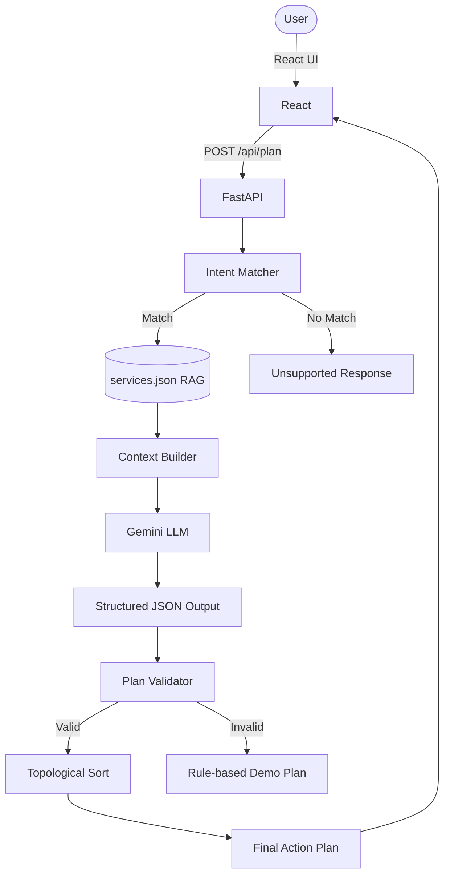

# Naviq: Government Service Reasoning Agent

**Built for Hackathon Problem Statement PS-45**

"Citizens navigate many portals and documents to finish one public-service process. Build an agent that understands procedural dependencies, identifies required steps, and gives evidence-backed guidance WITHOUT inventing unavailable services."

Naviq is a RAG-powered, multi-lingual, voice-enabled assistant that builds step-by-step verified action plans for Indian government services (Passport, Driving Licence, Aadhaar, PAN, Voter ID, etc.). 

## Architecture



## How We Prevent Invented Services (Hallucinations)
1. **Strict Knowledge Base**: The LLM is forced to use `services.json` as its only context via a strict prompt.
2. **Procedural Validation in Code**: The Python backend checks if every generated `step.id` exists in the verified database.
3. **Graceful Degradation**: If an intent doesn't match the 10 verified services, the system immediately returns an "unsupported service" message instead of guessing.

## SDG Mapping
- **SDG 10 (Reduced Inequalities)**: Voice input, multi-lingual support (English, Telugu, Hindi), and text-to-speech bridge the digital divide.
- **SDG 16 (Strong Institutions)**: Transparent steps, exact source links on every step, and timestamped verifications build trust.
- **SDG 17 (Partnerships)**: The open JSON knowledge base allows different state departments and NGOs to seamlessly contribute procedure data.

## Setup Instructions

1. **Clone & Setup Backend**
```bash
cd backend
python3 -m venv venv
source venv/bin/activate
pip install -r requirements.txt
cp .env.example .env
# Edit .env and add your GOOGLE_API_KEY
uvicorn main:app --host 0.0.0.0 --port 8000
```

2. **Setup Frontend**
```bash
cd frontend
cp .env.example .env
npm install
npm run dev
```

## Limitations & Future Work
- Currently supports 10 core services.
- Live verification of portal uptime is planned.
